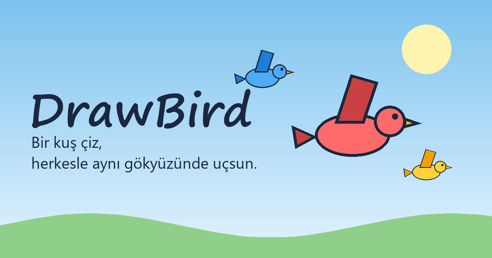

# DrawBird



**Bir kuş çiz, herkesin kuşlarıyla aynı gökyüzünde uçsun.**

🐦 Canlı: **https://drawbird.the-pit.workers.dev**

DrawBird tarayıcıda çalışan küçük bir çizim oyunu. Sağa bakan bir kuş çizersin, "uçur!" dersin; kuşun kanat çırparak ortak gökyüzüne katılır. Herkes kuşları oylar, sürüler kurar, yem atar.

*Draw a bird, watch it fly in a shared sky with everyone else's birds. Turkish UI, no sign-up, runs on Cloudflare's free tier.*

## Özellikler

### Çizim
- 9 renk + özel renk, silgi, kalınlık, geri al, temizle, yatay çevir
- Kanat çizgisi: çizimin üst yarısı kanat olarak çırpar, alt yarısı gövde olarak kalır
- Dokunmatik ekran, fare ve kalem desteği

### Ortak gökyüzü
- En yeniler / En sevilenler / Rastgele görünümü, 1–100 kuş, hız ayarı
- Yeni kuş gelince bildirim
- Yem at: Shift+tık, sağ tık ya da telefonda "Yem modu"; kuşlar yeme uçup gagalar
- Gece / gündüz, silinen kuşlar havalanıp kaybolur

### Topluluk
- ▲ / ▼ oy, Yükselen / Puan / Tarih / Rastgele sıralama
- Kuşçu profili ve kuşçu adı
- Sürüler: beğendiğin kuşları topla, herkese açık ya da yalnız sana özel tut, gökyüzünde yalnız onları izle
- Paylaşım linkleri: `/k/<kuş>`, `/u/<kuşçu>`, `/s/<sürü>`; kuş linkleri sohbet uygulamalarında kuşun resmiyle önizlenir

### Güvenlik ve moderasyon
- Üyelik yok: tarayıcı rastgele bir cihaz kodu üretir, sunucu yalnız özetini (SHA-256) saklar
- Kurtarma kodu ile başka cihazda aynı hesaba geçiş
- Bildir: 3 bildirim alan kuş gökyüzünden iner
- Yönetim paneli: bildirilen kuşlar, bildirimleri temizle, sil, kuşçuyu engelle
- Kişi başı 8 kuş, 12 sürü; çizim boyutu sunucuda sınırlı

## Nasıl çalışır

| Katman | Teknoloji |
| --- | --- |
| Sayfa | Tek dosya HTML + Canvas, çerçeve yok |
| API | Cloudflare Worker (`src/worker.js`) |
| Veri | Cloudflare D1 (SQLite) |
| Önbellek | Gökyüzünün ortak kısmı kenar önbelleğinde 10 sn tutulur |
| Barındırma | Workers Static Assets |

Gökyüzü 30 saniyede bir yenilenir; sekme arka plandayken durur.

## Proje yapısı

```
public/
  index.html            oyunun tamamı (çizim, gökyüzü, sıralama, profil, yönetim)
  gizlilik.html         gizlilik ve kurallar
  manifest.webmanifest  ana ekrana eklenebilir uygulama
  icons/, og-card.png
src/worker.js           API, paylaşım önizlemeleri
migrations/             D1 şeması
wrangler.jsonc          Cloudflare ayarları
```

## Kendi bilgisayarında çalıştır

Node.js 20+ gerekir.

```bash
npm install
npx wrangler d1 migrations apply drawbird --local
echo ADMIN_KEY=yerel-anahtar > .dev.vars
npx wrangler dev
```

Sonra http://localhost:8787 adresini aç. Yönetim panelini görmek için Profil → Yönetici anahtarı alanına `.dev.vars` içindeki anahtarı yaz.

## Kendi Cloudflare hesabına kur

```bash
npx wrangler login
npx wrangler d1 create drawbird          # çıkan database_id'yi wrangler.jsonc'ye yaz
npx wrangler d1 migrations apply drawbird --remote
npx wrangler secret put ADMIN_KEY        # yönetici anahtarı
npx wrangler deploy
```

Ücretsiz Workers planı ve D1 ücretsiz kotası küçük ve orta trafik için yeterlidir.

## API

| Yöntem | Yol | Ne yapar |
| --- | --- | --- |
| GET | `/api/state` | Kuşlar, adlar, sürüler, senin oyların |
| GET | `/api/img/:id` | Kuşun resmi |
| POST | `/api/birds` | Kuş gönder `{name, img}` |
| DELETE | `/api/birds/:id` | Kendi kuşunu sil |
| POST | `/api/vote` | `{bird, v: 1 \| -1 \| 0}` |
| POST | `/api/flag` | `{bird, on}` |
| POST | `/api/me` | Kuşçu adı `{name}` |
| POST | `/api/flocks` … | Sürü kur, düzenle, kuş ekle/çıkar |
| GET/POST | `/api/admin/*` | Yönetim (`x-admin-key` başlığı) |

Yazma istekleri `Authorization: Bearer <cihaz kodu>` başlığı ister.

## İlham

Fikir, Alden Hallak'ın [DrawAFish.com](https://drawafish.com) oyunundan esinlendi. DrawBird'ün kodu sıfırdan yazıldı; DrawAFish'in kodu, görselleri veya modeli kullanılmadı.

## Lisans

Kod [GNU AGPL-3.0](LICENSE) ile lisanslıdır: kopyalayıp değiştirebilir ve yayınlayabilirsin, ama değiştirdiğin sürümü internette sunarsan kaynak kodunu da aynı lisansla açman gerekir.

Kullanıcıların çizimleri bu lisansa dahil değildir; her çizim sahibine aittir (bkz. [gizlilik ve kurallar](public/gizlilik.html)).

🔗 Kaynak: https://github.com/gunayboss/drawbird
